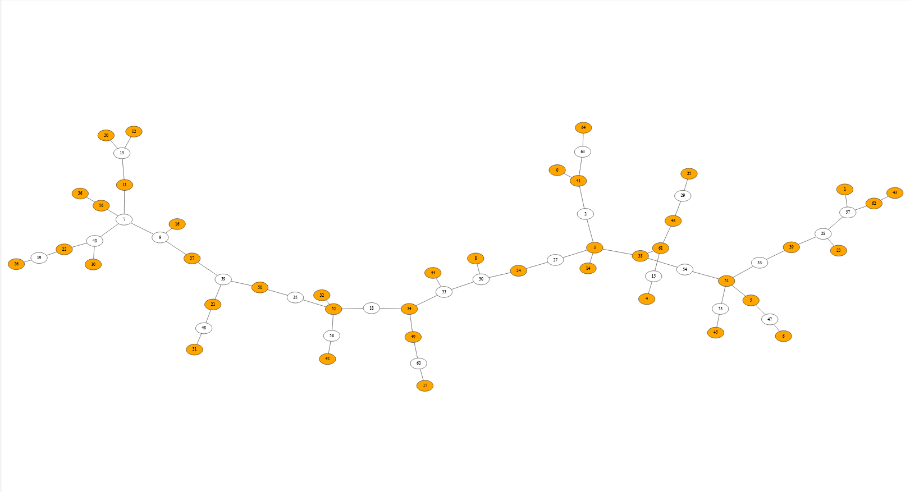
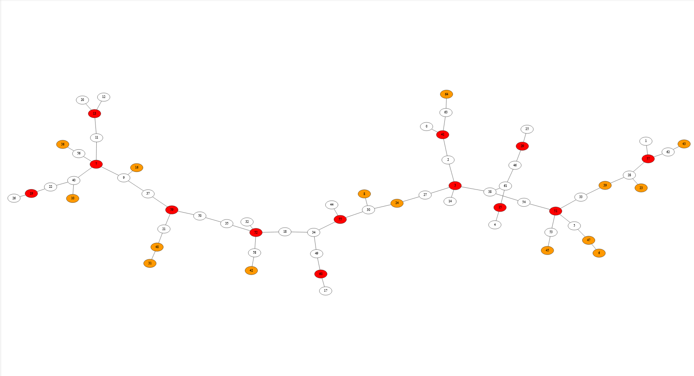
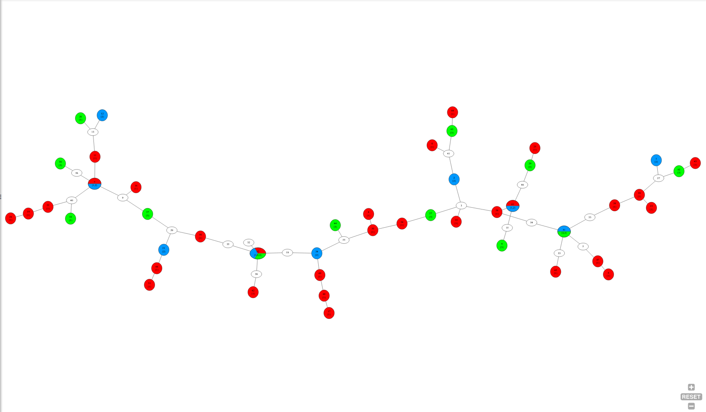

# Domination in Trees

This project implements, benchmarks, and visualizes exact linear-time / dynamic programming algorithms for various graph **domination problems specifically on trees** in C++20.

---

## Algorithms & Theoretical Background

1. **Total Domination ($\gamma_t$)**
   - Every vertex (even those in the dominating set) must be adjacent to at least one vertex in the dominating set.
   - Algorithm: Bottom up propagation (Bound / Required / Needed / Free).
   - Reference: [A survey of selected recent results on total domination in graphs (Henning, 2009)](https://www.sciencedirect.com/science/article/pii/S0012365X07010400) *(Note: algorithm in the survey contains an edge-case error; corrected in this implementation).*

2. **Restrained Domination ($\gamma_r$)**
   - Every vertex not in the dominating set $S$ must have a neighbor in $S$ AND a neighbor in $V \setminus S$ (no isolated vertices in the complement).
   - Algorithm: 5-state DP on trees with backtracking.
   - Reference: [Restrained domination in graphs (Domke et al., 1999)](https://www.sciencedirect.com/science/article/pii/S0012365X99000163) (page 8 / marked as 68). The transition table error in the original paper was corrected based on [Trees, Tables and Algorithms (Goddard et al.)](https://goddard.people.clemson.edu/papers/treesTablesAlgorithms.pdf), pages 5–6.

3. **2-Domination ($\gamma_2$)**
   - Every vertex outside the dominating set must be adjacent to at least 2 vertices in the dominating set.
   - Algorithm: 4-state DP table with backtracking. No reference - constructed it myself (according to [Trees, Tables and Algorithms (Goddard et al.)](https://goddard.people.clemson.edu/papers/treesTablesAlgorithms.pdf) it is called the Bern–Lawler–Wong technique; more here: [Bern et al., 1987](https://www.sciencedirect.com/science/article/abs/pii/0196677487900393?via%3Dihub)).

4. **Roman Domination ($\gamma_R$)**
   - Vertices are assigned weights $\{0, 1, 2\}$. Every vertex with weight 0 must have at least one neighbor with weight 2. Total cost $\sum f(v)$ is minimized.
   - Algorithm: 4-state DP with cost minimization and top-down reconstruction. No reference - constructed it myself using the same Bern–Lawler–Wong technique.

5. **$k$-Rainbow Domination ($\gamma_{rk}$)**
   - Vertices receive a subset of colors from $\{1, 2, \dots, k\}$. Every vertex with an empty color set must see all $k$ colors among its neighbors.
   - Algorithm: Exact implementation of greedy split-index algorithm.
   - Reference: [The $k$-rainbow domination problem on trees (Chang, Wu, Chang, 2010)](https://www.sciencedirect.com/science/article/pii/S0166218X09003370).

---

## Requirements

- **Docker Engine**

---

## What `docker-compose up --build` Actually Does

Just run:

```bash
docker-compose up --build
```

Here is the exact step-by-step breakdown of what happens under the hood when you run this command:

1. **Builds the Docker image**:
   - Pulls `gcc:latest` base image (already contains `g++` and `make`, nothing else is installed).
   - Sets the working directory to `/app`.
2. **Mounts the host volume**:
   - Maps `./src` from your host to `/app/src` inside the container. Anything generated in `src/output/` or `src/input/generated_trees/` instantly persists on your actual machine.
3. **Injects environment variables** from `docker-compose.yml`:
   - `TREE_SIZES`: Tree sizes (number of vertices $V$) to benchmark (e.g. `512 1024 2048 4096 8192 16384`).
   - `TREES_PER_BATCH`: How many trees to test per size (e.g. `1000`).
   - `K_RAINBOW_VALUES`: List of $k$ parameters for rainbow domination (e.g. `3 5 10`).
   - `PREVIEWS_PER_VARIANT`: Number of visual preview trees to output (e.g. `1`).
   - `PREVIEWS_SIZE`: Node count for the preview trees (e.g. `256`).
   - `CHECK_CORRECTNESS`: `1` verifies that every solution is a valid dominating set of its variant (runs after timing, so it does not affect measured times), `0` skips it.
   - `BRUTE_FORCE_MAX_SIZE`: Compares every algorithm's weight against an exhaustive search on **all** non-isomorphic trees with `2..N` vertices (generated by nauty `gentreeg`), plus hardcoded k-rainbow counterexamples. Results go to `brute_force_log.txt`. `0` skips it. Keep `N` small (e.g. `9`): the search grows exponentially, especially for large `k`.
   - `TZ`: Configures the container timezone (e.g. `Europe/Warsaw`) so folder timestamps match local time.
4. **Extracts and builds `nauty2_9_3`**:
   - If not already built, extracts `nauty2_9_3.tar.gz`, executes `./configure && make`, and builds `genrang` and `showg`.
5. **Generates dataset (`src/input/generate_trees.sh`)**:
   - Checks if `.generated_trees.config` matches the current environment variables.
   - If changed or missing, generates random trees using `genrang -t <size>` and converts them into edge lists with `showg -e` into `src/input/generated_trees/generated_trees.txt` and `preview_trees.txt`.
6. **Compiles the C++ source**:
   - Invokes `g++ -std=c++20 -O3 -DMAX_K=... src/*.cpp -o src/build/main` (where `MAX_K` is dynamically set from `K_RAINBOW_VALUES`).
7. **Runs the benchmark binary** (`./src/build/main`):
   - Creates a timestamped directory: `src/output/DD.MM.YYYY_HH-MM-SS/`.
   - Runs all domination algorithms against each tree size batch, logging execution and loading times.
   - Saves summary and progress to `benchmark_log.txt` (and prints to console).
   - Generates `.dot` graphviz preview files for every domination variant inside subfolders (`total_domination/`, `restrained_domination/`, `2-domination/`, `roman_domination/`, `k-rainbow_domination/`).
8. **Finishes and exits**:
   - Flushes output buffers, sleeps 200ms to ensure docker streams all logs, and cleanly exits.

---

## How to View Graph Previews (Tutorial)

The benchmark generates `.dot` files in `src/output/<timestamp>/<variant>/1.dot`.

> **Performance Note on Graph Sizes:**
> - **$< 1\,000$ nodes**: Works smoothly, renders fast.
> - **$< 8\,000$ nodes**: Works okay, browser might pause for a few seconds during layout calculation.
> - **$> 8\,000$ nodes**: Not recommended, but possible.


1. Open your generated `.dot` file (e.g., `src/output/04.10.2026_13-14-00/roman_domination/1.dot`) and **copy the entire content**.
2. Go to **[GraphvizOnline](https://dreampuf.github.io/GraphvizOnline/)** and paste the content into the left editor pane.
3. Wait for the engine to finish rendering (it uses `sfdp` layout pre-configured in the dot file).
4. Click **Download SVG** (or copy the generated SVG code).
5. Open the downloaded `.svg` file in any text editor (VS Code, Notepad) and **copy the whole text**.
6. Open **[SVGViewer](https://www.svgviewer.dev/)** and paste the SVG code into the editor.
7. In the bottom toolbar, click the **Frame / Center View** button  ⛶  to center and fit the graph onto your canvas.
8. Smooth dragging and zooming will now work without UI lag.

---

## Visualizations

Example renderings generated from `.dot` files in GraphvizOnline:

### 1. 2-Domination ($\gamma_2$)
- 🟠 **Orange nodes**: Vertices in the dominating set.



### 2. Roman Domination ($\gamma_R$)
- 🔴 **Red nodes (weight 2)**: Defending vertices.
- 🟠 **Orange nodes (weight 1)**: Self-defended vertices.
- ⚪ **White nodes (weight 0)**: Defended by at least one adjacent red node.



### 3. 3-Rainbow Domination ($\gamma_{r3}$)
- 🎨 **Colored nodes**: Vertices assigned a subset of colors from $\{1, 2, 3\}$.
- ⚪ **White nodes**: Vertices with $\emptyset$ receiving all colors from their neighbors.

